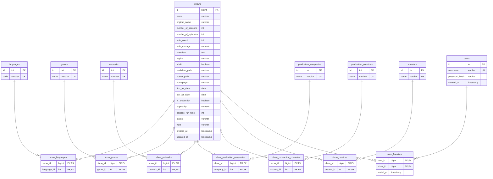
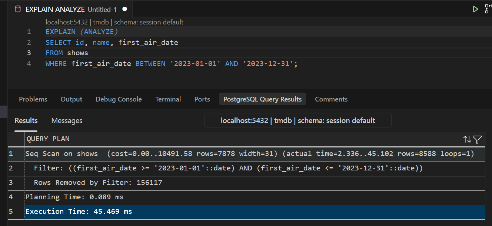
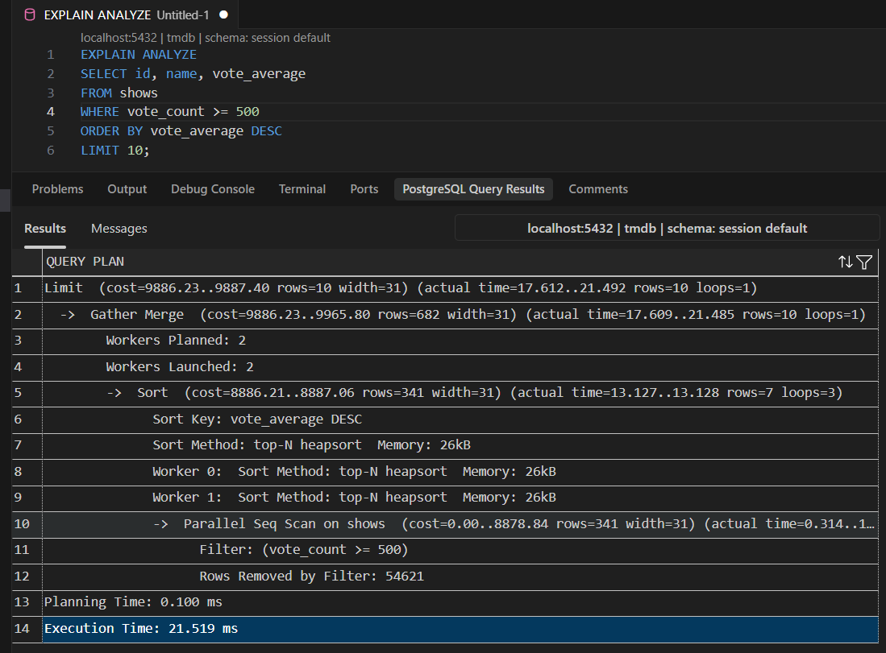
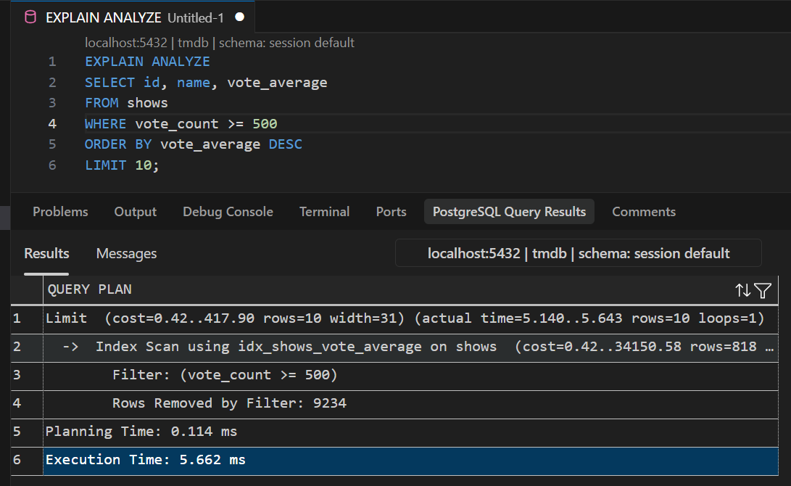
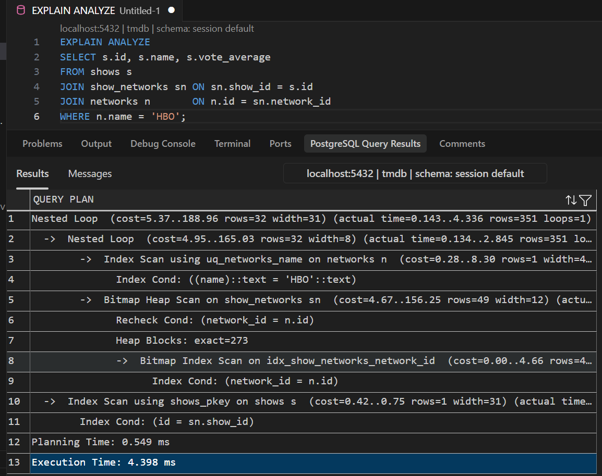

# TMDB TV Shows Database

Relationele PostgreSQL-database voor analyse en beheer van de **Full TMDb TV
Shows Dataset 2024 (150K Shows)**. Het project normaliseert de oorspronkelijke
CSV naar een relationeel model in derde normaalvorm (3NF), zodat
tv-recensenten, studio's en data-analisten efficiënt informatie over meer dan
150.000 televisieshows kunnen opzoeken en analyseren.

Brondata: [Full TMDb TV Shows Dataset 2024 (150K Shows) op Kaggle](https://www.kaggle.com/datasets/asaniczka/full-tmdb-tv-shows-dataset-2023-150k-shows)

## Use-case

De database vormt de gegevenslaag van een webapplicatie voor:

- het zoeken en filteren van televisieshows op titel, datum, score, genre,
  netwerk, taal en productiemaatschappij;
- het analyseren van populariteit, beoordelingen, genres, netwerken en
  productielanden;
- het tonen van samenvattingen en statistieken via databaseviews;
- het beheren van gebruikers en hun persoonlijke favorietenlijsten.

De applicatie gebruikt een vaste PostgreSQL-verbinding als `app_user`.
Eindgebruikers werken uitsluitend via de webapplicatie en krijgen geen
rechtstreekse databaseverbinding.

## Features

- PostgreSQL 16 als RDBMS.
- DDL voor tabellen, constraints, foreign keys, enumtypes, triggers en
  gegenereerde identity keys.
- DML en bulk-import van de TMDB-CSV via een tijdelijke stagingtabel en
  PostgreSQL `COPY`.
- Normalisatie naar 3NF met aparte dimensietabellen en many-to-many-koppeltabellen.
- Complexe `SELECT`-query's met `JOIN`, subqueries en `GROUP BY`.
- **Views** (5) voor showoverzichten, netwerkstatistieken, genrestatistieken,
  topshows per genre en veilige gebruikersgegevens.
- **Indexen** (12) voor substring-zoekopdrachten (GIN), datums, scores en koppeltabellen.
- **Sequences** (7) via PostgreSQL identity columns voor alle dimensietabellen.
- **Databasebeveiliging** met rollen, privileges en Row-Level Security (RLS).

## Database-structuur

De centrale tabel `shows` bevat de TMDB-metadata. Herbruikbare waarden staan
in aparte tabellen:

- `languages`, `genres`, `networks`, `production_companies`,
  `production_countries` en `creators`;
- `users` voor applicatiegebruikers en `user_favorites` voor de persoonlijke favorieten van een gebruiker.

De many-to-many-relaties worden opgeslagen in `show_languages`, `show_genres`, `show_networks`,
`show_production_companies`, `show_production_countries` en `show_creators`.

### ERD



## Toegang en beveiliging

| Actor               | Database-account/rol              | Toegang                                                                                                                             |
| ------------------- | --------------------------------- | ----------------------------------------------------------------------------------------------------------------------------------- |
| Beheerder           | `admin_user` / `admin_role`       | Volledig beheer van schema en data.                                                                                                 |
| Webapplicatie       | `app_user` / `app_role`           | Lezen van showdata via `readonly_role`; `SELECT` op `vw_users_safe` (zonder `password_hash`); `INSERT`, `UPDATE` en `DELETE` op `users` en `user_favorites`. Geen leesrechten op `users`. |
| Data-analist        | `analyst_user` / `analyst_role`   | Lezen via `readonly_role` en tijdelijke views maken voor analyses.                                                                  |
| Read-only gebruiker | `readonly_user` / `readonly_role` | Alleen `SELECT` op alle tabellen behalve `users`.                                                                                   |
| Eindgebruiker       | Geen database-account             | Werkt uitsluitend via de webapplicatie.                                                                                             |

De applicatie stelt per
transactie de ingelogde gebruiker in:

```sql
SET LOCAL app.current_user_id = '1';
```

RLS op `user_favorites` gebruikt deze waarde om toegang af te dwingen. Een
gebruiker kan daardoor alleen eigen favorieten zien, toevoegen, wijzigen of
verwijderen; favorieten van andere gebruikers blijven onzichtbaar.

Wachtwoorden worden niet als plaintext opgeslagen: `users.password_hash` bevat
een bcrypt-hash. De wachtwoorden in `schema.sql` zijn uitsluitend demo-credentials.
Wijzig ze voor elke echte deployment en bewaar secrets buiten versiebeheer.

## Setup

### Vereisten

- Docker met Docker Compose.
- Voor de volledige import: toegang tot de Kaggle-dataset.

### Database starten

```bash
docker compose up -d --build
```

Bij een nieuwe PostgreSQL-volume wordt `db/schema.sql` automatisch uitgevoerd,
inclusief de seed data. De database is bereikbaar op `localhost:5432` met
database `tmdb` en standaardgebruiker `tmdb_admin` (zie
`docker-compose.yml` voor configuratie).

### Volledige dataset importeren

1. Download en unzip de dataset van
   [Kaggle](https://www.kaggle.com/datasets/asaniczka/full-tmdb-tv-shows-dataset-2023-150k-shows)
   in de projectroot.
2. Kopieer de CSV naar de container:

    ```bash
    docker cp TMDB_tv_dataset_v3.csv tmdb_postgres:/tmp/TMDB_tv_dataset_v3.csv
    ```

3. Voer de bulk-import uit:

    ```bash
    docker exec -i tmdb_postgres psql -U tmdb_admin -d tmdb < db/import_full_dataset.sql
    ```

Het importscript:

1. laadt de CSV met `COPY` in `staging_shows`;
2. verwijdert dubbele show-id's;
3. vult de dimensietabellen;
4. vult `shows` en de koppeltabellen;
5. valideert de import;
6. verwijdert de stagingtabel en voert `ANALYZE` uit.

Verwachte output:

```text
=== Import voltooid ===
shows               : 164705
languages           : 143
genres              : 20
networks            : 3431
production_companies: 21867
production_countries: 184
creators            : 32227
```

## Analytische queryvoorbeelden

### Gemiddelde score per genre

```sql
SELECT
    g.name AS genre,
    COUNT(*) AS aantal_shows,
    ROUND(AVG(s.vote_average), 2) AS gemiddelde_score
FROM genres g
JOIN show_genres sg ON sg.genre_id = g.id
JOIN shows s ON s.id = sg.show_id
GROUP BY g.id, g.name
ORDER BY gemiddelde_score DESC;
```

### Top 10 shows per netwerk

```sql
WITH ranked_shows AS (
    SELECT
        n.name AS netwerk,
        s.name AS show,
        s.vote_average,
        s.vote_count,
        ROW_NUMBER() OVER (
            PARTITION BY n.id
            ORDER BY s.vote_average DESC, s.vote_count DESC, s.id
        ) AS rang
    FROM networks n
    JOIN show_networks sn ON sn.network_id = n.id
    JOIN shows s ON s.id = sn.show_id
    WHERE s.vote_count >= 500
)
SELECT netwerk, show, vote_average, vote_count
FROM ranked_shows
WHERE rang <= 10
ORDER BY netwerk, rang;
```

Daarnaast zijn de volgende views beschikbaar:

- `vw_show_overview`
- `vw_network_stats`
- `vw_genre_stats`
- `vw_top_shows_by_genre`

## Indexbenchmark

De testen zijn uitgevoerd met `EXPLAIN ANALYZE` op dezelfde database-inhoud.
Elke indextest vergelijkt een query zonder de relevante index (sequential scan)
met dezelfde query nadat de index is aangemaakt (index scan). De
uitvoeringstijden zijn afhankelijk van hardware, PostgreSQL-configuratie en
cache state; onderstaande waarden zijn de resultaten die in dit project zijn
vastgelegd.

| Test | Querydoel                 | Seq. scan | Index scan | Snelheidswinst |
| ---- | ------------------------- | --------: | ---------: | -------------: |
| 1    | Substring zoeken op titel | 70,968 ms |   0,592 ms |     **119,9x** |
| 2    | Filteren op datum         | 45,469 ms |   4,994 ms |       **9,1x** |
| 3    | Top 10 op score           | 21,519 ms |   5,662 ms |       **3,8x** |
| 4    | Reverse lookup            | 18,216 ms |   4,398 ms |       **4,1x** |

De originele query's voor de 4 testen zijn:

```sql
-- Test 1: substring zoeken op titel
DROP INDEX IF EXISTS idx_shows_name;

EXPLAIN ANALYZE
SELECT id, name, vote_average
FROM shows
WHERE name ILIKE '%dragon%';

CREATE INDEX idx_shows_name ON shows USING gin (name gin_trgm_ops);

-- Test 2: filteren op datum
DROP INDEX IF EXISTS idx_shows_first_air_date;

EXPLAIN ANALYZE
SELECT id, name, first_air_date
FROM shows
WHERE first_air_date BETWEEN '2023-01-01' AND '2023-12-31';

CREATE INDEX idx_shows_first_air_date ON shows (first_air_date);

-- Test 3: sorteren op score
DROP INDEX IF EXISTS idx_shows_vote_average;

EXPLAIN ANALYZE
SELECT id, name, vote_average
FROM shows
WHERE vote_count >= 500
ORDER BY vote_average DESC
LIMIT 10;

CREATE INDEX idx_shows_vote_average ON shows (vote_average DESC);

-- Test 4: reverse lookup via koppeltabel
DROP INDEX IF EXISTS idx_show_networks_network_id;

EXPLAIN ANALYZE
SELECT s.id, s.name, s.vote_average
FROM shows s
JOIN show_networks sn ON sn.show_id = s.id
JOIN networks n ON n.id = sn.network_id
WHERE n.name = 'HBO';

CREATE INDEX idx_show_networks_network_id ON show_networks (network_id);
```

### Benchmarkresultaten

#### Test 1: titel zoeken

| Sequential scan                                | Index scan                                  |
| ---------------------------------------------- | ------------------------------------------- |
|  |  |

#### Test 2: datumfilter

| Sequential scan                                | Index scan                                  |
| ---------------------------------------------- | ------------------------------------------- |
|  |  |

#### Test 3: sortering op score

| Sequential scan                                | Index scan                                  |
| ---------------------------------------------- | ------------------------------------------- |
|  |  |

#### Test 4: reverse lookup

| Sequential scan                                | Index scan                                  |
| ---------------------------------------------- | ------------------------------------------- |
|  |  |

## Projectbestanden

```text
.
├── docker-compose.yml
├── db/
│   ├── schema.sql                 # DDL, seed data, views, indexen en security
│   └── import_full_dataset.sql    # CSV bulk-import en normalisatie
└── benchmark/                     # Indexanalyse-screenshots
```
